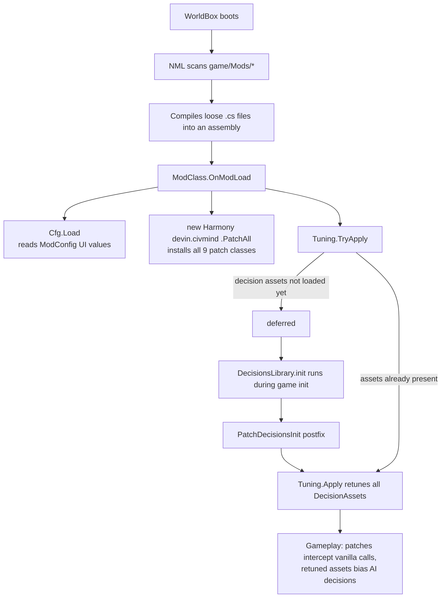
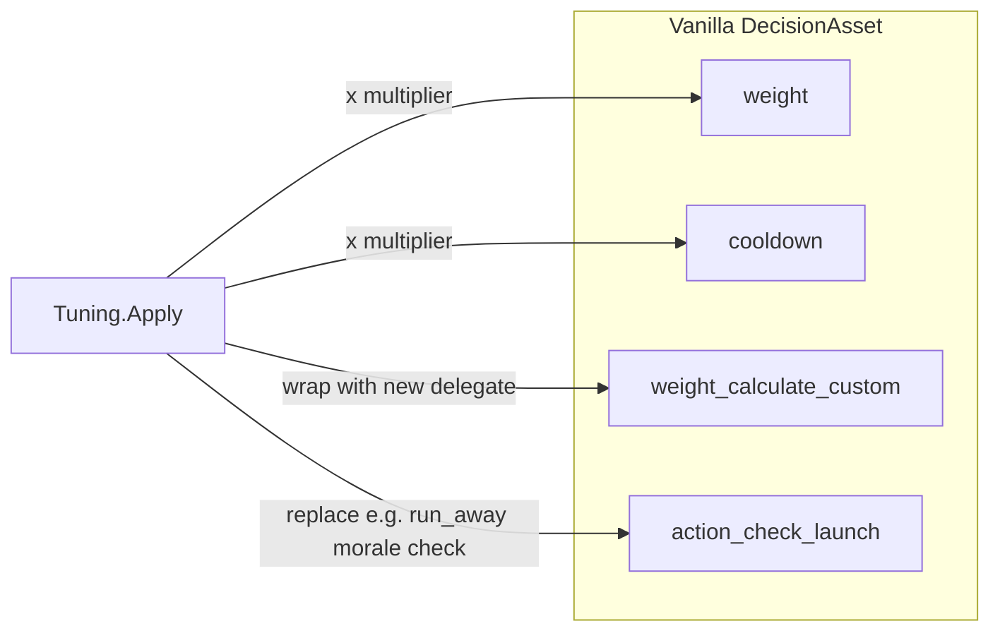

# Architecture

How Civ Mind Overhaul is wired: the mod-loading lifecycle, the two mechanisms it uses to change
game behavior, and a complete map of hooks into vanilla code.

## Components

| File | Role |
|---|---|
| `mod/Main.cs` | NML entry point (`BasicMod<ModClass>`). Loads config, applies Harmony patches, kicks off tuning. |
| `mod/Cfg.cs` | Static config class. Binds ~30 `ModConfig` sliders/switches to static fields with fallback defaults. |
| `mod/Patches.cs` | All Harmony patch classes — the control-flow side of the mod. |
| `mod/Tuning.cs` | Asset retuning — the data side. Mutates `DecisionAsset` weights, cooldowns, and delegates. |
| `mod/mod.json` | NML manifest (GUID `devin.civmind`, `targetGameBuild: 719`). |
| `mod/default_config.json` | Declares the in-game config UI (groups → sliders/switches). |
| `mod/Locales/en.json` | Human-readable labels for each config id. |

## Runtime lifecycle

The deferred path matters: `OnModLoad` fires before `AssetManager.decisions_library` is populated, so
`TryApply` no-ops and the real work happens in the `DecisionsLibrary.init` postfix. Tuning is applied
exactly once per game boot and snapshots originals so it stays idempotent.

## Two mechanisms

The mod changes behavior through two complementary mechanisms — picking the right one is the
core design decision for any new feature.

### 1. Harmony patches (control flow)

Used when a vanilla *method's logic* needs to change. Three shapes appear in `Patches.cs`:

- **Prefix-supplant** — the patch does the whole job and returns `false` to skip vanilla.
  Example: `PatchFindCaptain` replaces "nearest unit" with a merit pick.
- **Prefix-veto / prefix-with-fallback** — the patch handles a special case and either consumes the
  call (`return false`) or falls through to vanilla (`return true`). Example: `PatchSetCitizenJob`
  handles draft/priority/aptitude paths then lets vanilla's round-robin run.
- **Postfix augmentation** — vanilla runs, then the patch adds effects. Example:
  `PatchCitizenTasks` tops up job slots after the city board refills.

Every patch is gated by a `Cfg.*` flag, wraps its body in `try/catch`, and on any exception
falls back to vanilla behavior (prefix → `return true`, postfix → log and swallow). A broken
patch should degrade to vanilla, never crash the game.

### 2. Asset retuning (data mutation)

Used when the right fix is just *numbers*: `DecisionAsset.weight`, `cooldown`, or swapping
`weight_calculate_custom` / `action_check_launch` delegates for richer behavior
(`Tuning.cs`). Originals are snapshotted in `_origWeight`/`_origCooldown`/`_origCustom`
so multipliers apply to vanilla values, not to previously-tuned ones.

Rule of thumb: **retune for "more/less often" and "different score"; patch for "different procedure."**

## Patch map

Every hook point, its mechanism, and its config gate:

| Patch class | Vanilla target | Type | Config gate | Feature |
|---|---|---|---|---|
| `PatchDecisionsInit` | `DecisionsLibrary.init` | postfix | — | Triggers `Tuning.Apply` once assets exist |
| `PatchSetCitizenJob` | `City.setCitizenJob` | prefix | `AptitudeHiring`, `EmergencyDraft` | Draft bypass + aptitude hiring |
| `PatchWarriorStillOk` | `City.checkIfWarriorStillOk` | prefix | `EmergencyDraft` | Stay mobilized in danger |
| `PatchEndJob` | `Actor.endJob` | prefix+postfix | `JobXpAmount > 0` | Job XP (captures `citizen_job` in `__state`) |
| `PatchCitizenTasks` | `CityBehCheckCitizenTasks.execute` | postfix | `Extra*`/`Draft*` options | Pressure staffing + militia slots |
| `PatchSimGlobalsInit` | `SimGlobals.init` | postfix | `War{Timeout,MinWarriors,Peace}Years` | War tempo globals |
| `PatchOkToSendArmy` | `City.isOkToSendArmy` | prefix-supplant | `MarchFill` | March threshold |
| `PatchFindCaptain` | `Army.findCaptain` | prefix-supplant | `MeritCaptains` | Merit-based captain |
| `PatchGetWarTarget` | `DiplomacyHelpers.getWarTarget` | prefix-supplant | `SmartWarTarget` | Scored war targets |
| `PatchFindTargetCity` | `CityBehCheckAttackZone.findTargetCity` | prefix-supplant | `SmartCityTarget` | Scored siege targets |
| `PatchWarUpdate` | `War.update` | postfix | `WarStalemateYears > 0`, `WarscoreSurrender` | Stalemate auto-peace + warscore surrender |
| `PatchArmyTick` | `Army.checkCaptainExistence` | prefix+postfix | `MoraleShock`, `FocusFire`, `Duels`, `Pillage`, `DesertionWarYears` | Per-army tick dispatcher: shock bookkeeping → focus fire → duels → pillage → desertion |
| `PatchGetHit` | `Actor.getHit` | prefix (ref pDamage) | `HomeField` | Home-field damage reduction |
| `PatchWarriorTaxi` | `BehCityActorWarriorTaxiCheck.execute` | postfix | `NavalInvasions` | Follow embarked captain cross-island |
| `PatchIncreaseKills` | `Actor.increaseKills` | postfix | `BerserkerRage` | Kill-streak → `rage` status + war-hero kill tally |
| `PatchEndWar` | `WarManager.endWar` | postfix | `Reparations`, `WarHeroes` | Loser gold → winner capital + hero traits + `PeaceTime` |
| `PatchSuccessionClan` | `SuccessionTool.getKingFromRoyalClan` | postfix (ref `__result`) | `MeritSuccession` | Best-stat royal-clan heir |
| `PatchSuccessionLeaders` | `SuccessionTool.getKingFromLeaders` | postfix (ref `__result`) | `MeritSuccession` | Best-stat leader heir |
| `PatchAllianceTarget` | `DiplomacyHelpers.getAllianceTarget` | prefix-supplant | `BalanceAlliances` | Nearest-valid alliance partner |
| `PatchFlee` | `BehFindRandomFarTile.execute` | prefix | `RallyFlee` | Flee toward captain / own city |
| `PatchTryWarrior` | `City.tryToMakeWarrior` | prefix | `MilitiaReserve` | Peacetime warrior fill cap |
| `PatchSetLeader` | `City.setLeader` | prefix (ref `pActor`) | `MeritLeaders` | Stewardship-scored leader swap |
| `PatchCheckLoyalty` | `CityBehCheckLoyalty.execute` | postfix | `Uprisings`, `SiegeStarvation`, `Assimilation`, `Wages` | Uprising trigger + siege food drain + culture/religion conversion + soldier-wage drain |
| `PatchIsWarNeeded` | `DiplomacyHelpers.isWarNeeded` | postfix (ref `__result`) | `KingPersonality`, `WarChest` | Pacifist veto / warlord bypass / treasury war funding |
| `PatchSetKing` | `Kingdom.setKing` | postfix | `PretenderWars`, `CollapsePressure` | Pretender revolt / province drift |
| `PatchPlotsInit` | `PlotsLibrary.init` | postfix | `AntiHegemon` | Wraps `alliance_destroy.check_is_possible` |
| `PatchSupplyCities` | `CityBehSupplyKingdomCities.execute` | prefix+postfix | `WarTribute`, `SupplyWarMult`, `FamineRelief` | Prefix retargets supply to hungriest city; postfix: wartime tribute + faster aid |
| `PatchGiveTax` | `BehActorGiveTax.execute` | prefix+postfix | `TaxUnrest`, `Corruption` | Tax-rate happiness dip + `__state` king-loot diff skim to leader |
| `PatchCityTarget` | `BehFindNearbyPotentialCivCityToJoin.getPotentialCityNearby` (static) | prefix-supplant | `LaborMigration` | Migrants pick cities by open job slots + kingdom + distance |
| `PatchMercenary` | `Actor.joinCity` | postfix | `Mercenaries` | City pays `MercenaryCost` → migrant `money` → `tryToMakeWarrior` |
| `PatchDockTarget` | `ai.ActorTool.getDockTradeTarget` (static) | postfix (ref `__result`) | `Embargo` | Nulls docks whose kingdom is at war with any alliance member |
| `PatchBorderSteal` | `CityBehBorderSteal.execute` | postfix | `BorderPressure` | Extra wartime zone steal |
| `PatchBoatTrade` | `BehBoatMakeTrade.execute` | postfix | `TradeIncome` | Distance-scaled trade gold to boat inventory |
| `PatchGiveItem` | `City.giveItem` (static) | prefix+postfix | `EquipmentMarket` | `__state` equipped-value diff → charge `money` → city gold |

Plus tuning-only features with no dedicated patch class (see `Tuning.Apply`):
`find_city_job` demand weight, expansion/social/reproduction weights, housing-gated
reproduction, `run_away` morale check (also consumes `WarFx.Shaken` and applies the
commander aura), `warrior_train_with_dummy`, `check_warrior_transport` retunes, the
`check_join_city`/`check_join_empty_nearby_city` refugee weight wraps, and the economy
retunes: `give_tax`, `make_items`, `try_to_take_city_item` (danger spike),
`boat_trading`/`boat_fishing` (wartime blockade wrap).

`WarFx` (in `Patches.cs`) is a tiny shared-state holder: `Shaken: armyId → Time.time` expiry,
written by `PatchArmyTick` on field captain-death and read by the `run_away` delegate;
`HeroKills: actorId → wartime kill count`, fed by `PatchIncreaseKills` and consumed by
`PatchEndWar`; `PeaceTime: kingdomId → world time of last war end`, read by
`PatchCitizenTasks` for the reconstruction surge; `Broke: kingdomId → Time.time` expiry,
stamped by `PatchCheckLoyalty` when a city can't make payroll and read by `TickDesertion`
for the unpaid-mutiny desertion multiplier.

`Rebel` (in `Patches.cs`) holds the shared rebellion plumbing — reflected `makeOwnKingdom`,
`startWar`, `City.kingdom`, `setCulture`, `setReligion` handles plus the once-per-city
`Revolted` set — used by `PatchCheckLoyalty` (occupied uprisings), `PatchSetKing`
(pretender wars / province drift), and `PatchBorderSteal` (kingdom lookups).

## Reflection access

The mod reads `internal`/`private` members via cached `AccessTools` handles
(static readonly `FieldInfo`/`MethodInfo`, resolved once per patch class). Everything goes through
null-checked invocation — if a game update renames a member, the patch degrades gracefully.

| Member | Access | Used by |
|---|---|---|
| `City._timer_warrior` | field | `PatchSetCitizenJob` (draft cooldown check) |
| `City.tryToMakeWarrior` | method | `PatchSetCitizenJob` (warrior conversion) |
| `Actor.isProfession` | method | `PatchSetCitizenJob` |
| `BaseSimObject.stats` | field | `PatchSetCitizenJob` (aptitude stats) |
| `Actor.addExperience` | method | `PatchEndJob` |
| `City.hasBuildingToBuild`, `hasStorageBuilding`, `hasBuildingType` | method | `PatchCitizenTasks` |
| `City.kingdom`, `City.city_center` | field | `PatchFindTargetCity`, `PatchArmyTick` (pillage) |
| `Actor.hasWeapon` | method | `Tuning.ReworkRetreat` |
| `Actor.attack_target`, `Actor.has_attack_target` | field | `PatchArmyTick` (focus fire) |
| `Actor.data` | field | `PatchArmyTick` (pillage — `ActorData.loot` set), `PatchIsWarNeeded` (war chest), `PatchGiveItem` (`ActorData.money`) |
| `Actor.beh_building_target` | field | `PatchBoatTrade` (foreign dock for distance) |
| `BaseSimObject.stats` → `BaseStats["multiplier_supply_timer"]` | field/indexer | `PatchSupplyCities` (replicated `updateSupplyTimer`) |
| `BaseBuildingComponent.building` | field | `PatchDockTarget` (dock → city for embargo check) |
| `City.tryToMakeWarrior` | method | `PatchMercenary` (instant enlistment) — also patched by `PatchTryWarrior` |
| `BaseSimObject.addStatusEffect(string,float,bool)` | method | `PatchIncreaseKills` |
| `Actor.getHit` | internal override | `PatchGetHit` (patched by name, `ref pDamage`) |
| `City.kingdom` | field | `PatchEndWar`, `PatchCheckLoyalty` |
| `City.zones` | field | `PatchFlee` (rally fallback target) |
| `Actor.beh_tile_target` | field | `PatchFlee` |
| `City.makeOwnKingdom` | method | `Rebel` (secession — uprisings, pretenders, drift) |
| `DiplomacyManager.startWar` | method | `Rebel` (rebellion wars) |
| `Actor.data` | field | `Rebel`/`PatchIsWarNeeded` (`ActorData.money` war chest) |
| `City.setCulture`, `City.setReligion` | method | `PatchCheckLoyalty` (assimilation) |
| `City.addZone`, `City.removeZone` | method | `PatchBorderSteal` (zone grab) |

See [patching-guide.md](patching-guide.md) for the conventions in detail.
