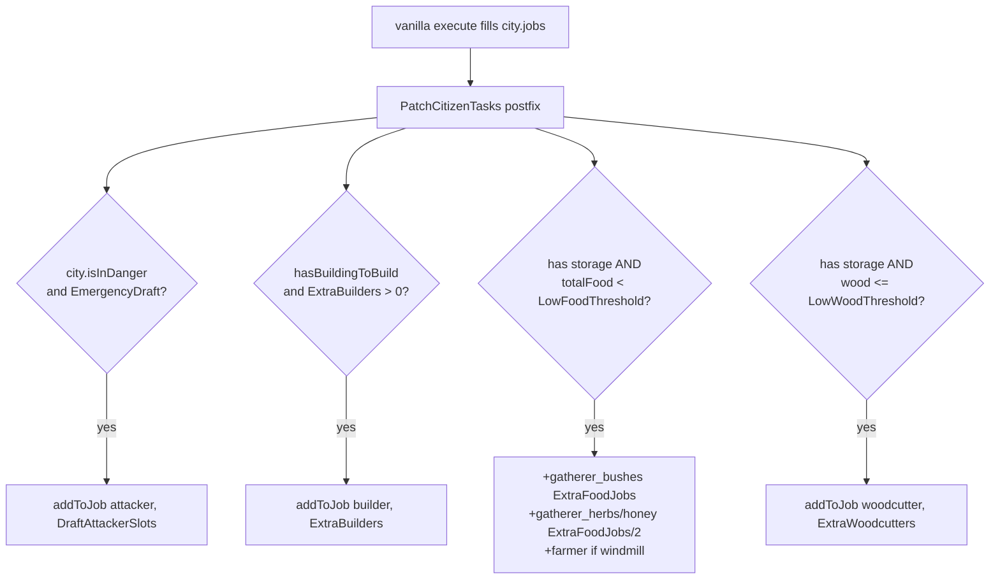
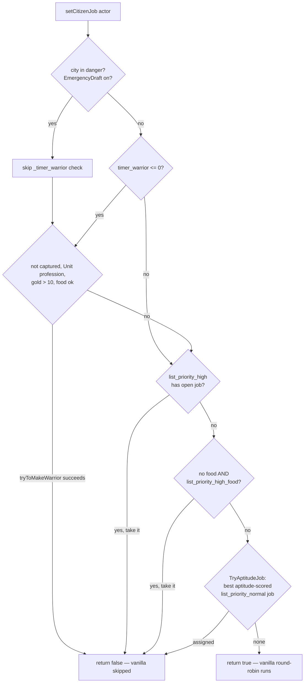

# Citizen & City AI Features (features 1–6)

What the mod changes about civilian behavior, and exactly where each change lands.
Vanilla background: [vanilla-ai-primer.md](vanilla-ai-primer.md) § "City jobs".

## Feature overview

| # | Feature | Mechanism | Key config |
|---|---|---|---|
| 1 | Demand-aware job seeking | Tuning: custom weight + cooldown on `find_city_job` | `JobSeekWeight`, `JobSeekCooldown`, `JobDemandBoost` |
| 2 | Pressure staffing | `PatchCitizenTasks` postfix tops up `city.jobs` | `Extra*`, `Low*Threshold`, `DraftAttackerSlots` |
| 3 | Aptitude hiring + emergency draft | `PatchSetCitizenJob` prefix (mirrors vanilla flow) | `AptitudeHiring`, `EmergencyDraft` |
| 4 | Stay mobilized in danger | `PatchWarriorStillOk` prefix | `EmergencyDraft` |
| 5 | Housing-gated reproduction | Tuning: housing check in reproduction weight | `HousingCrisis`, `NoHouseReproMult` |
| 6 | Job XP | `PatchEndJob` prefix/postfix | `JobXpAmount` |

## 1. Demand-aware job seeking

Vanilla `find_city_job` has a flat weight — idle citizens drift toward work at the same rate
whether the city has 20 openings or zero. `Tuning.JobSeekWeight` replaces it:

```csharp
score  = (starving ? 0.3 : hungry ? 1 : 2) * JobSeekWeight
score += min(openSlots, 4) * JobDemandBoost   // if city has open job slots
```

Starving units actually deprioritize job hunting (they should be finding food); well-fed ones
seek work hardest. The demand term caps at 4 open slots so it plateaus instead of snowballing.
Cooldown is cut to `JobSeekCooldown` × vanilla (default 0.4×) so units retry sooner.

## 2. Pressure staffing

`PatchCitizenTasks` (postfix on `CityBehCheckCitizenTasks.execute`) adds extra job slots on top
of the vanilla refill, same gating (`SystemCityTasks` debug flag + `population_adults > 0`):



`addToJob` is public and additive — slots vanish naturally as the board rebalances next tick.

## 3. Aptitude hiring + emergency draft

`PatchSetCitizenJob` (prefix on `City.setCitizenJob`) mirrors the vanilla decision order,
injecting the draft shortcut and an aptitude-scored pick:



Aptitude scoring (`PatchSetCitizenJob.Aptitude`):

| Job(s) | Score |
|---|---|
| `builder`, `road_builder` | `stats["construction_speed"] + stewardship × 0.5` |
| `hunter`, `attacker` | `warfare + stats["accuracy"] × 0.5` |
| `farmer`, `woodcutter`, `miner`, `miner_deposit`, gatherers | `stewardship` |
| anything else | `0.01` (floor so vanilla fallback still matters) |

Respects `ok_for_king`/`ok_for_leader`/`only_leaders`/`should_be_assigned` before scoring.

## 4. Stay mobilized in danger

Vanilla `checkIfWarriorStillOk` demobilizes warriors when the army is over limit or food is
short — even mid-siege. `PatchWarriorStillOk` forces `true` (keep the spear) while
`city.isInDanger()`, gated by `EmergencyDraft`.

## 5. Housing-gated reproduction

`Tuning.RetuneHousing` wraps `sexual_reproduction_try`'s weight:

```csharp
a.hasHouse() ? base * ReproductionWeight
             : base * NoHouseReproMult   // default 0.15
```

Works whether vanilla used a flat `weight` or a `weight_calculate_custom` delegate (both
branches handled). Cities with housing shortages get a demographic brake instead of
infinite homeless babies.

## 6. Job XP

`Actor.endJob()` clears `citizen_job` — so `PatchEndJob` uses the classic two-step:

```csharp
Prefix:  __state = __instance.citizen_job;   // capture before it's cleared
Postfix: if (__state != null) addExperience(JobXpAmount);  // reflected — method is internal
```

Gives workers a slow career-progression trickle (default 5 XP per completed job stint).
