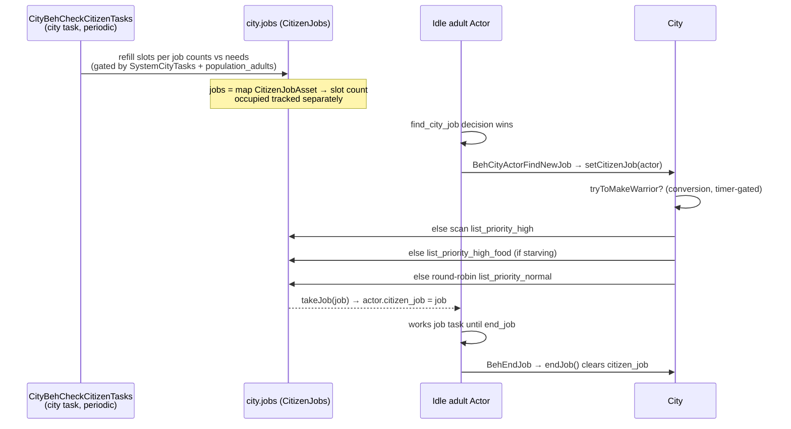
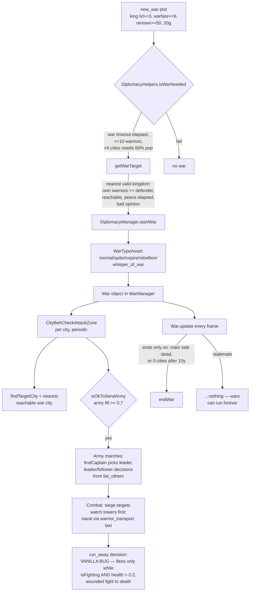

# WorldBox AI Primer (0.51.x / build 719)

How the game decides what every unit does, how cities staff jobs, and how wars start and end —
the vanilla systems the mod hooks. Everything here is from the decompiled `Assembly-CSharp`
(see `decompiled/` locally; curated pieces in `game-api/`).

## Unit AI: utility-based decisions

Each actor tick runs `UtilityBasedDecisionSystem.useOn(Actor)`, which:

1. **Builds a candidate list** from several sources (see "Decision lists" below).
2. **Filters** each `DecisionAsset` through `isPossible(...)` flag checks plus `DecisionChecks`
   (a cached snapshot of actor state — hungry, fighting, adult, civ, etc.).
3. **Scores** survivors: either the flat `weight` field or `weight_calculate_custom(actor)`
   when `has_weight_custom` is set. Scores go through a softmax — effectively `e^w` —
   and one decision is picked by weighted random.
4. **Launches** the winning decision's behaviour task (`task_id`), subject to `cooldown`
   (a per-decision refractory period) and `action_check_launch` (a last-chance gate run
   at launch time — e.g. vanilla `run_away` re-verifies the actor is fighting).

### `DecisionAsset` fields that matter

```csharp
public DecisionAction action_check_launch;   // launch-time gate
public float weight = 1f;                    // base score
public bool has_weight_custom;               // use weight_calculate_custom instead
public DecisionActionWeight weight_calculate_custom; // dynamic score
public int cooldown;                         // refractory period
public NeuroLayer priority;                  // urgency tier (below)
public bool unique, only_adult, only_safe,   // filter flags
            city_must_be_safe, ...;
```

### NeuroLayer priorities

```csharp
enum NeuroLayer { Layer_0_Minimal, Layer_1_Low, Layer_2_Moderate,
                  Layer_3_High, Layer_4_Critical }
```

Decisions sit in urgency tiers. `Layer_4_Critical` (e.g. on fire) forces *priority-only* mode —
lower-tier options are skipped entirely. Some actors `isAbleToSkipPriorityLevels`, giving an
80% chance to bypass tier gating (flavor for chaotic creatures).

### Decision lists

Where candidates come from:

| Source | Contents |
|---|---|
| `DecisionsLibrary.list_only_civ` | Civilian behavior for city dwellers (jobs, social, housing) |
| `list_only_city` | City-scoped decisions |
| `list_only_children` | Kid behavior |
| `list_only_animal` | Animal behavior |
| `list_others` | Applies to everything non-boat — **including combat decisions like `run_away` and army orders** |
| per-`ActorAsset` list | Species-specific decisions |
| per-actor list | Individual extras |
| `ProfessionAsset` | Each profession (Nothing/Unit/Warrior/King/Leader) injects extra decision ids via `t.addDecision` — e.g. warriors get army orders |

**Mod relevance:** `Tuning` mutates `weight`/`cooldown`/delegates on these assets — one edit affects
every actor evaluating that decision. `run_away`'s `action_check_launch` is where the morale-retreat
logic lives.

## City jobs: the job board



Key pieces:

- `CitizenJobs` holds `jobs: Dictionary<CitizenJobAsset,int>` (slots) plus `occupied` counts.
  `addToJob(asset, n)` is public — safe for the mod to top up.
- Job assets (`CitizenJobLibrary`) carry filters: `only_leaders`, `ok_for_king`, `ok_for_leader`,
  and `should_be_assigned` (a public `CitizenJobCondition` delegate — a hook point that needs no patch).
- Priority lists built in `linkAssets`: `list_priority_high` (`priority > 0` — currently only
  `builder` @ 9), `list_priority_high_food` (`priority_no_food > 0` — the three gatherers @ 10),
  `list_priority_normal` (everything else `common_job`). `attacker` (militia) is `common_job = false`.
- **Warriors are jobs too.** `setCitizenJob` first calls `tryToMakeWarrior` — converts the unit
  to the Warrior profession if the army isn't full (`status.warrior_slots` cap synced from
  `countCurrentJobs(attacker)`), food allows, and `_timer_warrior` (15 s re-draft cooldown) elapsed.
- `checkIfWarriorStillOk` demobilizes warriors when `isArmyOverLimit` or `!hasEnoughFoodForArmy`.
- Aptitude stats used by the mod: `a.warfare`, `a.stewardship`, `a.intelligence`, `a.diplomacy`
  are public ints; `stats` is `internal` on `BaseSimObject` → reflect once, then
  `stats["construction_speed"]` (public indexer) works.

## War & diplomacy pipeline

Wars in 0.51.x are **plots** — kingdom-level story events with prerequisites:



Notable details:

- `WarTypeAsset` flags: `total_war` (no negotiated end), `alliance_join`, `can_end_with_plot`.
- `eventFriendship`/`eventSpite` plots can end/start wars outside the normal pipeline.
- `SimGlobals.m` is a `public static SimGlobalAsset` holding war tempo numbers —
  `diplomacy_years_war_timeout` (5), `diplomacy_years_war_min_warriors` (10),
  `minimum_years_between_wars` (5), `minimum_kingdom_age_for_attack` (5). Pure data; the mod
  overrides them in a `SimGlobals.init` postfix.
- Naval invasions: `check_warrior_transport`/`BehCityActorWarriorTaxiCheck` ferry armies by boat.
- Training: `warrior_train_with_dummy` (requires a `type_training_dummies` building) →
  15% chance to grant a `pot_traits_combat` trait.

## Performance notes

- `ListPool<T>` — a pooled list *struct*. Must `Dispose()` in `finally` (the codebase avoids
  `using` declarations for old-compiler safety) and iterate via `pool[i]`.
- Beh tasks like `CityBehCheckCitizenTasks` and `CityBehCheckAttackZone` run on city ticks;
  `War.update` runs every frame — postfix work there must be cheap and/or throttled
  (the mod uses `Randy.randomChance(0.02)`).
- Decision evaluation happens per-actor per-decision-tick; `weight_calculate_custom` delegates
  should be allocation-free.

## Handy type index

`World.world` → `cities`, `kingdoms`, `wars`, `diplomacy` · `AssetManager` → `decisions_library`,
`citizen_job_library`, `professions`, `tasks_actor` · `Actor` → `city`, `citizen_job`, `army`,
`warfare`/`stewardship`/..., `isKingdomCiv()`, `hasTrait(id)` · `City` → `jobs`, `status`,
`isInDanger()`, `hasEnoughFoodForArmy()`, `getResourcesAmount(id)` · `War` → `getAge()`,
`getMainAttacker/Defender()`, `isTotalWar()`, `hasEnded()`
