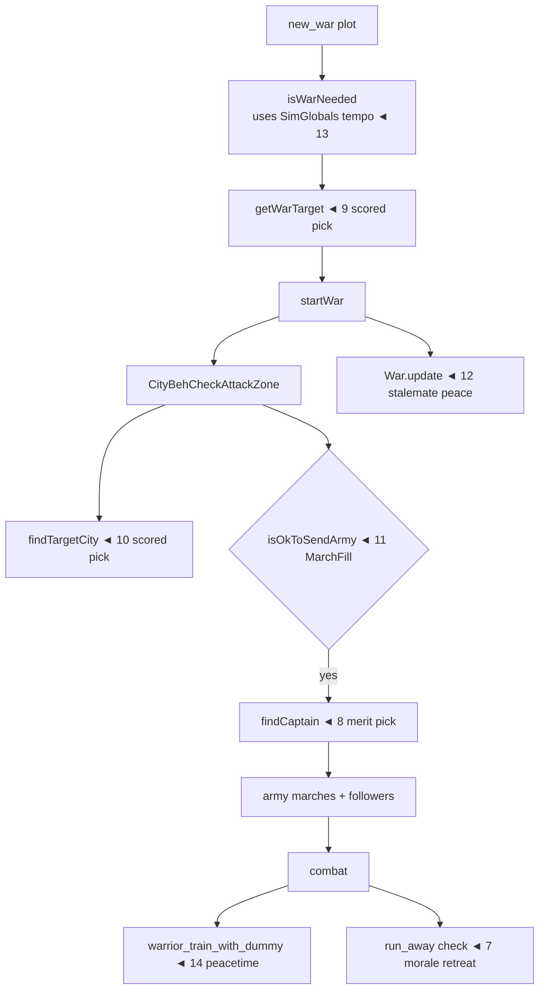
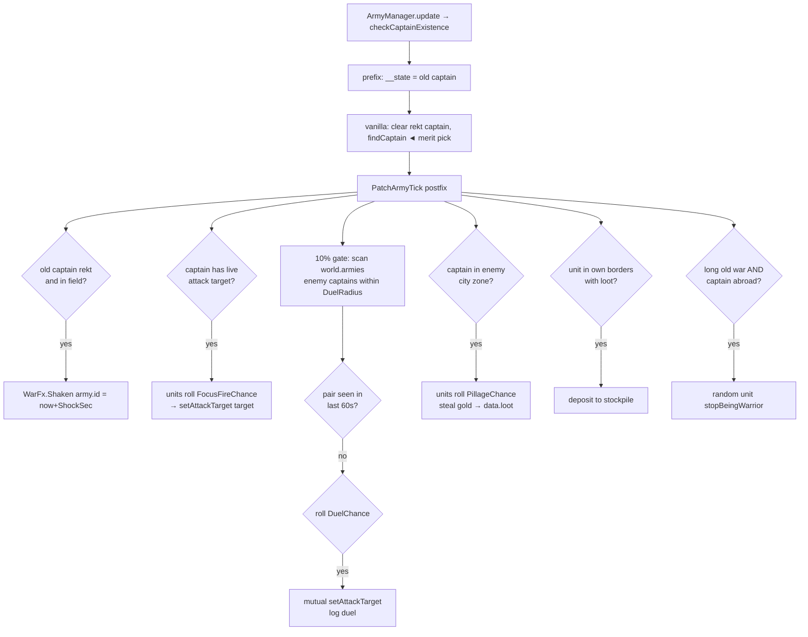

# Combat & War AI Features (features 7–14)

What the mod changes about fighting, armies, and diplomacy, and where each change lands.
Vanilla background: [vanilla-ai-primer.md](vanilla-ai-primer.md) § "War & diplomacy pipeline".

## Feature overview

| # | Feature | Mechanism | Key config |
|---|---|---|---|
| 7 | Morale retreat | Tuning: replaces `run_away` launch check | `MoraleRetreat`, `RetreatHealth`, `TraitMorale` |
| 8 | Merit captains | `PatchFindCaptain` prefix-supplant | `MeritCaptains` |
| 9 | Smart war targets | `PatchGetWarTarget` prefix-supplant | `SmartWarTarget` |
| 10 | Smart siege targets | `PatchFindTargetCity` prefix-supplant | `SmartCityTarget` |
| 11 | March threshold | `PatchOkToSendArmy` prefix-supplant | `MarchFill` |
| 12 | Stalemate peace | `PatchWarUpdate` postfix | `WarStalemateYears` |
| 13 | War tempo | `PatchSimGlobalsInit` postfix | `WarTimeoutYears`, `WarMinWarriors`, `WarPeaceYears` |
| 14 | Training retune | Tuning: weight/cooldown on `warrior_train_with_dummy` | `TrainWeight`, `TrainCooldown` |

v0.3 adds nine more features (15–23) riding a shared per-army tick — see **War Tactics** below.

## Where they land in the pipeline



## 7. Morale retreat

Vanilla `run_away` launches only while `isFighting() && healthRatio > 0.2` — units flee when
*healthy* but fight to the death when wounded. Backwards. `Tuning.ReworkRetreat` replaces
`action_check_launch`:

```csharp
threshold = armed ? RetreatHealth : max(RetreatHealth, 0.85)   // unarmed rout early
if TraitMorale:
    pacifist                 -> threshold *= 1.6   // routs readily
    bloodlust/savage/veteran -> threshold *= 0.5   // stands longer
    threshold += warfare * 0.003                    // veterans keep nerve
flee when healthRatio < threshold
```

Unarmed units get a high floor (0.85) so civilians scatter almost immediately; professional
soldiers with combat traits hold the line.

## 8. Merit captains

Vanilla `Army.findCaptain` picks the nearest or a random unit. `PatchFindCaptain` supplants it:
keeps a living civ captain, clears dead/non-civ ones, then picks `max(warfare * 2 + level)`
across units still assigned to the army and not `isRekt()`. Respects `isLocked()`.

## 9. Smart war targets

`PatchGetWarTarget` keeps every vanilla filter (defender weaker than own alliance-adjusted
warriors, reachable capital, minimum kingdom age, peace elapsed since last war, bad opinion)
but replaces "first nearest" with a score:

```
score = dist(kingdoms) * (0.4 + defender/own) * (hasWars(defender) ? 0.6 : 1)
```

Closer, weaker, and already-embattled targets win. Iterates `getNeutralKingdoms` via
`ListPool<Kingdom>` (disposed in `finally`).

## 10. Smart siege targets

`PatchFindTargetCity` — same idea one level down. Vanilla sends the whole army at the nearest
war city; the patch scores `dist * (0.5 + cityDefenders / max(5, ownWarriors))` over
`wars.getWarCities(kingdom)` filtered by reachability. `City.kingdom` and `City.city_center`
are internal → reflected `FieldInfo`s.

## 11. March threshold

Vanilla hardcodes 0.7 army fill in `isOkToSendArmy`. `PatchOkToSendArmy` supplants it with
`countUnits / getMaxWarriors >= MarchFill` (and `hasArmy()` first). Lower it for constant
skirmishing, raise it for only-full-strength campaigns.

## 12. Stalemate peace

`War.update` only ends wars on main-side death or 0 cities after 10 years — wars against
unreachable opponents run forever. `PatchWarUpdate` adds an exit:

```csharp
if war.getAge() >= WarStalemateYears
   && !war.isTotalWar() && !war.hasEnded()
   && Randy.randomChance(0.02)                    // throttle: every-frame method
   && both main kingdoms alive
   && !DiplomacyHelpers.isThereFightBetween(atk, def)   // real stalemate, not a lull
    -> wars.endWar(war, WarWinner.Peace)
```

`0=off` via `WarStalemateYears <= 0`. Logs `[CivMind] stalemate peace: <war>`.

## 13. War tempo

`PatchSimGlobalsInit` overwrites three `SimGlobalAsset` fields after `SimGlobals.init`:

| Field | Vanilla | Config |
|---|---|---|
| `diplomacy_years_war_timeout` | 5 | `WarTimeoutYears` — per-kingdom cooldown between war declarations |
| `diplomacy_years_war_min_warriors` | 10 | `WarMinWarriors` — minimum army size to declare |
| `minimum_years_between_wars` | 5 | `WarPeaceYears` — enforced rematch delay vs same kingdom |

`minimum_kingdom_age_for_attack` (5y) is left at vanilla.

## 14. Training retune

`warrior_train_with_dummy` (needs a `type_training_dummies` building; 15% chance of a combat
trait per session) gets `TrainWeight` × weight and `TrainCooldown` × cooldown — defaults 1.4×/0.6×
so barracks actually get used.

---

# War Tactics (features 15–23)

v0.3 adds a per-army tick hook — `PatchArmyTick` on `Army.checkCaptainExistence` (called every
tick by `ArmyManager.update` for every army). Its prefix captures the old captain in `__state`
(before vanilla elects a replacement); the postfix dispatches feature blocks in order:
**shock bookkeeping → focus fire → duels → pillage → desertion**. Expensive scans are gated by
`Randy.randomChance` so they run ~1×/sec per army, not every frame.



## 15. Warscore surrender

Inside `PatchWarUpdate` (shared `hasEnded`/`isTotalWar` guard): if `max(deadA, deadD) >=
WarscoreMinDeaths` and the kill ratio ≥ `WarscoreRatio`, the side that bled more surrenders via
`war.lostWar(loser)` — `removeFromWar` handles main-side checks and picks the `WarWinner`.
A `_warscoreDone` set makes it fire once per war (multi-kingdom wars could otherwise cascade —
`lostWar` re-calls `update()` reentrantly).

## 16. Focus fire

When the captain has a live `attack_target`, each warrior rolls `FocusFireChance` per tick to
adopt it. `attack_target`/`has_attack_target` are internal fields → cached `FieldInfo`s; the
write (`setAttackTarget`) is public.

## 17. Home-field advantage

`PatchGetHit` prefixes `Actor.getHit` (7 params, `ref pDamage`): a defender inside own city
borders takes `pDamage *= HomeFieldMult` (0.8 default). `pAttacker != null` excludes
self/environment damage.

## 18. Desertion

Abroad armies in wars older than `DesertionWarYears` (non-total) bleed a random unit per
`DesertionChance` gate via `stopBeingWarrior()`. Uses the army tick because vanilla's
`check_warrior_limit` decision only runs inside own borders — field armies never evaluate it.

## 19. Pillage

Captain standing in an enemy-zone city → each unit rolls `PillageChance` to steal
`min(cityGold, rand(1..PillageAmount))` into `ActorData.loot` (via reflected `Actor.data`).
Survivors deposit loot at home stockpiles when back in own borders — plunder physically travels
with the army.

## 20. Champion duels

10%-gated scan of `World.world.armies` for an enemy captain within `DuelRadius` tiles
(neither inside boats/buildings). Each army pair gets one roll per 60 s encounter window
(`_duelPairs` dedup) — pass `DuelChance` (50%) → mutual `setAttackTarget`. Synergy: merit
captains (feature 8) win duels.

## 21. Morale shock

Captain dies in the field (detected via `__state` in prefix — vanilla's `findCaptain` has
already replaced him) → `WarFx.Shaken[armyId] = Time.time + ShockSeconds`. The `run_away`
delegate multiplies the rout threshold by `ShockFleeMult` while shocked (capped at 0.95) —
kill the champion, break the army.

## 22. Naval invasions

`check_warrior_transport` retuned to ×1.75 weight / ×0.5 cooldown — vanilla already gates on
`hasAttackZoneOrder && !sameIsland`, and `TaxiManager.newRequest` merges same-kingdom/same-island
requests so the whole army piles into one boat. `PatchWarriorTaxi` postfix: when the vanilla
check returns `Stop`, a warrior whose captain is embarked on another island requests a taxi to
the captain's tile — followers chase the transport.

## 23. Berserker rage

`Actor.increaseKills` postfix (private method, patchable by name): kills within `RageWindowSec`
build a streak; at `RageKills` → `addStatusEffect("rage", RageDurationSec)` (internal method,
reflected). `rage` grants `multiplier_damage = 1.0` (double damage) but is `affects_mind` —
kept short (20 s default).
