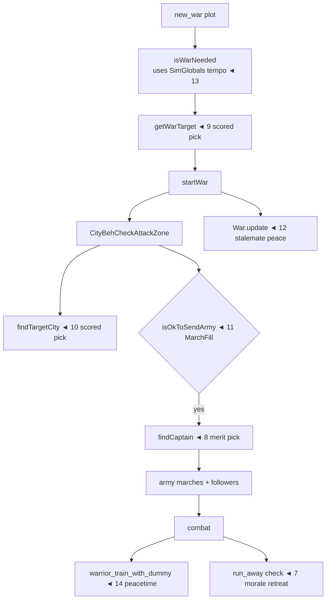
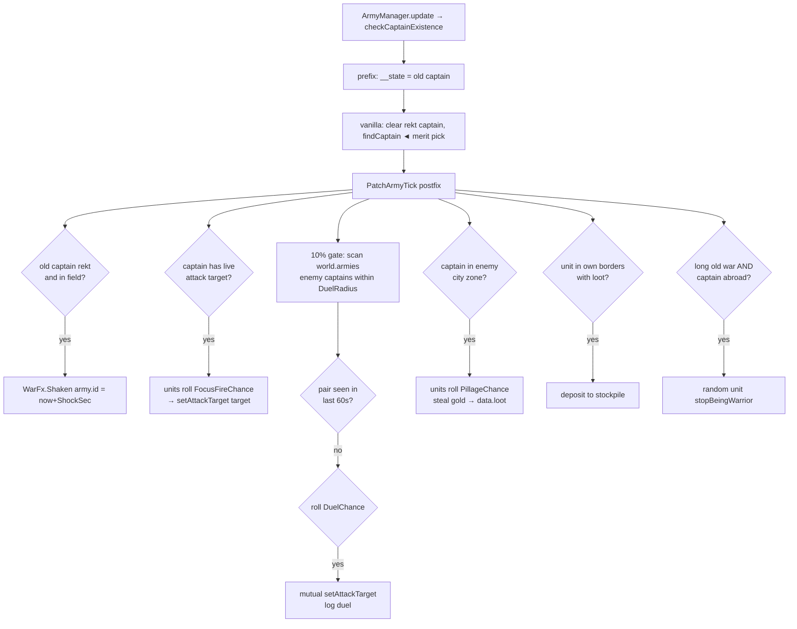

# Combat & War AI Features (features 7–33)

What the mod changes about fighting, armies, and diplomacy, and where each change lands.
Vanilla background: [vanilla-ai-primer.md](vanilla-ai-primer.md) § "War & diplomacy pipeline".

## Feature overview

| # | Feature | Mechanism | Key config |
|---|---|---|---|
| 7 | Morale retreat | Tuning: replaces `run_away` launch check | `MoraleRetreat`, `RetreatHealth`, `TraitMorale` |
| 8 | Merit captains | `PatchFindCaptain` prefix-supplant | `MeritCaptains` |
| 9 | Smart war targets | `PatchGetWarTarget` prefix-supplant | `SmartWarTarget` |
| 10 | Smart siege targets | `PatchFindTargetCity` prefix-supplant | `SmartCityTarget` |
| 11 | March threshold | `PatchOkToSendArmy` prefix-supplant | `MarchFill` |
| 12 | Stalemate peace | `PatchWarUpdate` postfix | `WarStalemateYears` |
| 13 | War tempo | `PatchSimGlobalsInit` postfix | `WarTimeoutYears`, `WarMinWarriors`, `WarPeaceYears` |
| 14 | Training retune | Tuning: weight/cooldown on `warrior_train_with_dummy` | `TrainWeight`, `TrainCooldown` |

v0.3 adds nine more features (15–23) riding a shared per-army tick — see **War Tactics** below.
v0.4 adds ten more (24–33) — see **Politics, Battlefield Polish & Home Front**.
v0.5 adds twelve more (35–46) — see **Realpolitik, Economy & Culture**.
v0.6 adds the economy pack (48–51) — see **Economy & Logistics**.
v0.7 deepens it (52–56): plunder-driven targeting, crown loot tax, soldier wages, trade-run income, and an equipment market.
v0.8 closes the loop (57–61): tax unrest, corruption, famine relief, labor migration, golden-age economies.

## Where they land in the pipeline



## 7. Morale retreat

Vanilla `run_away` launches only while `isFighting() && healthRatio > 0.2` — units flee when
*healthy* but fight to the death when wounded. Backwards. `Tuning.ReworkRetreat` replaces
`action_check_launch`:

```csharp
threshold = armed ? RetreatHealth : max(RetreatHealth, 0.85)   // unarmed rout early
if TraitMorale:
    pacifist                 -> threshold *= 1.6   // routs readily
    bloodlust/savage/veteran -> threshold *= 0.5   // stands longer
    threshold += warfare * 0.003                    // veterans keep nerve
flee when healthRatio < threshold
```

Unarmed units get a high floor (0.85) so civilians scatter almost immediately; professional
soldiers with combat traits hold the line.

## 8. Merit captains

Vanilla `Army.findCaptain` picks the nearest or a random unit. `PatchFindCaptain` supplants it:
keeps a living civ captain, clears dead/non-civ ones, then picks `max(warfare * 2 + level)`
across units still assigned to the army and not `isRekt()`. Respects `isLocked()`.

## 9. Smart war targets

`PatchGetWarTarget` keeps every vanilla filter (defender weaker than own alliance-adjusted
warriors, reachable capital, minimum kingdom age, peace elapsed since last war, bad opinion)
but replaces "first nearest" with a score:

```
score = dist(kingdoms) * (0.4 + defender/own) * (hasWars(defender) ? 0.6 : 1)
```

Closer, weaker, and already-embattled targets win. Iterates `getNeutralKingdoms` via
`ListPool<Kingdom>` (disposed in `finally`).

## 10. Smart siege targets

`PatchFindTargetCity` — same idea one level down. Vanilla sends the whole army at the nearest
war city; the patch scores `dist * (0.5 + cityDefenders / max(5, ownWarriors))` over
`wars.getWarCities(kingdom)` filtered by reachability. `City.kingdom` and `City.city_center`
are internal → reflected `FieldInfo`s.

## 11. March threshold

Vanilla hardcodes 0.7 army fill in `isOkToSendArmy`. `PatchOkToSendArmy` supplants it with
`countUnits / getMaxWarriors >= MarchFill` (and `hasArmy()` first). Lower it for constant
skirmishing, raise it for only-full-strength campaigns.

## 12. Stalemate peace

`War.update` only ends wars on main-side death or 0 cities after 10 years — wars against
unreachable opponents run forever. `PatchWarUpdate` adds an exit:

```csharp
if war.getAge() >= WarStalemateYears
   && !war.isTotalWar() && !war.hasEnded()
   && Randy.randomChance(0.02)                    // throttle: every-frame method
   && both main kingdoms alive
   && !DiplomacyHelpers.isThereFightBetween(atk, def)   // real stalemate, not a lull
    -> wars.endWar(war, WarWinner.Peace)
```

`0=off` via `WarStalemateYears <= 0`. Logs `[CivMind] stalemate peace: <war>`.

## 13. War tempo

`PatchSimGlobalsInit` overwrites three `SimGlobalAsset` fields after `SimGlobals.init`:

| Field | Vanilla | Config |
|---|---|---|
| `diplomacy_years_war_timeout` | 5 | `WarTimeoutYears` — per-kingdom cooldown between war declarations |
| `diplomacy_years_war_min_warriors` | 10 | `WarMinWarriors` — minimum army size to declare |
| `minimum_years_between_wars` | 5 | `WarPeaceYears` — enforced rematch delay vs same kingdom |

`minimum_kingdom_age_for_attack` (5y) is left at vanilla.

## 14. Training retune

`warrior_train_with_dummy` (needs a `type_training_dummies` building; 15% chance of a combat
trait per session) gets `TrainWeight` × weight and `TrainCooldown` × cooldown — defaults 1.4×/0.6×
so barracks actually get used.

---

# War Tactics (features 15–23)

v0.3 adds a per-army tick hook — `PatchArmyTick` on `Army.checkCaptainExistence` (called every
tick by `ArmyManager.update` for every army). Its prefix captures the old captain in `__state`
(before vanilla elects a replacement); the postfix dispatches feature blocks in order:
**shock bookkeeping → focus fire → duels → pillage → desertion**. Expensive scans are gated by
`Randy.randomChance` so they run ~1×/sec per army, not every frame.



## 15. Warscore surrender

Inside `PatchWarUpdate` (shared `hasEnded`/`isTotalWar` guard): if `max(deadA, deadD) >=
WarscoreMinDeaths` and the kill ratio ≥ `WarscoreRatio`, the side that bled more surrenders via
`war.lostWar(loser)` — `removeFromWar` handles main-side checks and picks the `WarWinner`.
A `_warscoreDone` set makes it fire once per war (multi-kingdom wars could otherwise cascade —
`lostWar` re-calls `update()` reentrantly).

## 16. Focus fire

When the captain has a live `attack_target`, each warrior rolls `FocusFireChance` per tick to
adopt it. `attack_target`/`has_attack_target` are internal fields → cached `FieldInfo`s; the
write (`setAttackTarget`) is public.

## 17. Home-field advantage

`PatchGetHit` prefixes `Actor.getHit` (7 params, `ref pDamage`): a defender inside own city
borders takes `pDamage *= HomeFieldMult` (0.8 default). `pAttacker != null` excludes
self/environment damage.

## 18. Desertion

Abroad armies in wars older than `DesertionWarYears` (non-total) bleed a random unit per
`DesertionChance` gate via `stopBeingWarrior()`. Uses the army tick because vanilla's
`check_warrior_limit` decision only runs inside own borders — field armies never evaluate it.

## 19. Pillage

Captain standing in an enemy-zone city → each unit rolls `PillageChance` to steal
`min(cityGold, rand(1..PillageAmount))` into `ActorData.loot` (via reflected `Actor.data`).
Survivors deposit loot at home stockpiles when back in own borders — plunder physically travels
with the army.

## 20. Champion duels

10%-gated scan of `World.world.armies` for an enemy captain within `DuelRadius` tiles
(neither inside boats/buildings). Each army pair gets one roll per 60 s encounter window
(`_duelPairs` dedup) — pass `DuelChance` (50%) → mutual `setAttackTarget`. Synergy: merit
captains (feature 8) win duels.

## 21. Morale shock

Captain dies in the field (detected via `__state` in prefix — vanilla's `findCaptain` has
already replaced him) → `WarFx.Shaken[armyId] = Time.time + ShockSeconds`. The `run_away`
delegate multiplies the rout threshold by `ShockFleeMult` while shocked (capped at 0.95) —
kill the champion, break the army.

## 22. Naval invasions

`check_warrior_transport` retuned to ×1.75 weight / ×0.5 cooldown — vanilla already gates on
`hasAttackZoneOrder && !sameIsland`, and `TaxiManager.newRequest` merges same-kingdom/same-island
requests so the whole army piles into one boat. `PatchWarriorTaxi` postfix: when the vanilla
check returns `Stop`, a warrior whose captain is embarked on another island requests a taxi to
the captain's tile — followers chase the transport.

## 23. Berserker rage

`Actor.increaseKills` postfix (private method, patchable by name): kills within `RageWindowSec`
build a streak; at `RageKills` → `addStatusEffect("rage", RageDurationSec)` (internal method,
reflected). `rage` grants `multiplier_damage = 1.0` (double damage) but is `affects_mind` —
kept short (20 s default).

---

# Politics, Battlefield Polish & Home Front (features 24–33)

v0.4 adds three packs. Politics wraps the end-of-war path and the succession/alliance
helpers; Battlefield Polish extends the `run_away` delegate and flee behaviour; Home Front
adds refugee pressure, merit leaders, and occupied-city revolts.

## 24. Merit succession

Vanilla `SuccessionTool.getKingFromLeaders`/`getKingFromRoyalClan` pick the heir via
`ActorTool.attributeDice` — a literal dice roll. The postfixes rescore `__result`:
`max(diplomacy + stewardship + warfare*0.5 + level)` across eligible candidates (clan
members that pass `fitToRule`, or living city leaders). Best-stat heir, deterministic.

## 25. War reparations

`WarManager.endWar` postfix: when the war ends with `WarWinner.Attackers` or `Defenders`
(not `Peace`), the losing main kingdom's cities each pay `ReparationsPct`% of their
`gold` stockpile into the winner's capital (`takeResource` →
`addResourcesToRandomStockpile`). Skipped when the winner has no capital.

## 26. War heroes

`PatchIncreaseKills` feeds `WarFx.HeroKills[actorId]` — but only while the killer's
kingdom is at war, so peacetime hunting doesn't count. At `endWar`, each main side's top
killer with ≥ `HeroMinKills` wartime kills gets `addTrait("veteran")` and a log line;
that side's entries are then cleared so the award fires once per war.

## 27. Balance-of-power alliances

`getAllianceTarget` prefix-supplant. All vanilla eligibility checks are preserved
(no supreme kingdom, valid king, no active plot, good opinion, renown ≥
`alliance_create.min_renown_kingdom`, proximity or 2-city-isolation exception) but the
random `LoopRandom` pick is replaced by `argmin(distanceBetweenKingdom)` — kingdoms
prefer their nearest valid partner, so contiguous regional blocs form instead of
scattered marriages of convenience. `ListPool` disposed in `finally`.

## 28. Commander aura

Inverse of morale shock: in the `run_away` delegate, a living captain within
`AuraRadius` tiles multiplies the unit's rout threshold by `AuraFleeMult` (0.6) —
troops hold longer while their leader stands. Applied **before** the shock multiplier
so the existing 0.95 cap still bounds the combined result.

## 29. Rally flee

`BehFindRandomFarTile` prefix (the behaviour `run_away` uses to pick a destination):
army units flee **toward their captain's tile**, or failing that a random zone center
of their own city, instead of a random far tile. `beh_tile_target` and `City.zones`
are internal → reflected. Non-army actors and missing targets fall through to vanilla.
Returns `BehResult.Continue` so `BehGoToTileTarget` runs as usual.

## 30. Militia reserve

`City.tryToMakeWarrior` prefix: in peacetime, conversion is refused once
`warriors_current >= warrior_slots × ReservePeacetimeRatio` — cities march at ~60%
strength and keep a garrison at home. `isInDanger` bypasses the cap, so the emergency
draft (feature 3) still fills every slot.

## 31. War refugees

`check_join_city`/`check_join_empty_nearby_city` weights wrapped (same pattern as the
housing gate): actors with `city == null` whose kingdom is at war get
`× RefugeeBoost` — displaced civilians actively seek shelter instead of wandering.
Multiplies through vanilla custom weight delegates where present; `0` disables.

## 32. Merit leaders

`City.setLeader` prefix with `ref pActor`: scans `city.units` for eligible citizens
(`is_profession_citizen`, not king/leader); a candidate must beat the vanilla pick's
`stewardship + level*0.5` by `LeaderMargin` to swap in — avoids churn when vanilla
already picked someone decent.

## 33. Occupied-city uprisings

`CityBehCheckLoyalty` postfix — vanilla calls `getLoyalty(true)` every ~2 s per city,
which is the perfect periodic probe. A city revolts when **all** hold:

- not the capital, and `_uprisingDone` hasn't fired for it
- `world_law_rebellions` enabled
- `getLoyalty() < UprisingLoyalty` (30)
- `Date.getYearsSince(timestamp_kingdom) < UprisingRecentYears` (10) — recently conquered
- `randomChance(UprisingChance)` (0.02 per check → ~1%/s)

Then: pick a rebel (city leader, else a `isUnitFitToRule` citizen), remove their
leadership, `makeOwnKingdom` (internal → reflected) to secede, `startWar(oldK, newK,
WarTypeLibrary.rebellion)` (internal → reflected), `WorldLog.logCityRevolt`, and
`checkMoreAlignedCities` so neighbouring unhappy cities can join the revolt — the same
plumbing `DiplomacyHelpersRebellion.startRebellion` uses, minus its hard `Plot`
requirement. In v0.5 this moved into the shared `Rebel` helper so other features
(pretender wars, collapse drift) reuse it.

---

# Realpolitik, Economy & Culture (features 35–46)

v0.5 deepens the political layer: kings shape foreign policy by their stats,
succession crises spawn pretender revolts, wartime economies strain, and
culture/religion starts to matter.

## 35. King personality

`isWarNeeded` postfix with `ref __result`. Vanilla only checks structural gates
(warriors, timeout, population) — never who the king is.

- **Pacifist veto** — a diplomatic king (`diplomacy ≥ PeaceKingDiplomacy` and
  `diplomacy > warfare`) vetoes a `true` result with `PeaceVetoChance` probability.
- **Warlord bypass** — a high-warfare king (`warfare ≥ WarlordWarfare`) reruns the
  structural gates *minus* the army-size and 60%-population requirements with
  `WarlordChance` — warlords declare with smaller forces (still ≥ `WarlordMinWarriors`).

## 36. Anti-hegemon coalitions

Two parts. In `PatchAllianceTarget`, when a `isSupreme` kingdom exists, candidates
bordering it get `dist × HegemonBonusMult` — neighbours band together to contain
the blob. And `Tuning.WrapPlots` (via `PatchPlotsInit`) relaxes `alliance_destroy`'s
`check_is_possible`: vanilla requires the initiator be supreme/2nd-best *and* the
alliance hold > 2× all rivals' power — the mod lets any member break a bloc that
contains a supreme kingdom (10y membership/age floors kept).

## 37. Pretender wars

`Kingdom.setKing` postfix (`!pFromLoad`). After a coronation, the best non-capital
city leader or royal-clan member whose merit score beats `king + PretenderMargin`
seizes their city and launches a rebellion war — weak puppet kings invite coups.
Uses `Rebel.SparkRevolt`.

## 38. Collapse pressure

Same hook, different outcome: if the new king's score is below `CollapseKingScore`
and the kingdom has >2 cities, the lowest-loyalty non-capital city (loyalty < 40)
simply leaves — `makeOwnKingdom(leader, pRebellion:false, pFellApart:true)` mirrors
vanilla `checkKingdomChaos`, one province at a time instead of a full fracture.

## 39. War tribute & supply surge

`CityBehSupplyKingdomCities` postfix. During war: non-capital cities roll
`TributeChance` to send `TributePct`% of their gold surplus (above `TributeMinGold`)
to the capital — the war effort concentrates in the capital; and the shared-supply
cooldown `timer_supply` is multiplied by `SupplyWarMult` (0.5 → aid runs ~2× as often).

## 40. Siege starvation

`PatchCheckLoyalty`: a city `isInDanger` rolls `SiegeDrainChance` per ~2s check →
`getRandomStockpile().resources.getRandomFoodAsset()` → `takeResource(id,
SiegeFoodDrain)`. Stockpiled food trickles out while enemies are inside the walls —
long sieges starve the garrison, feeding the existing `hasAnyFood`/`hungry` systems.

## 41. Border pressure

`CityBehBorderSteal` postfix — during war, an extra `tryStealZone` attempt per
`BorderPressureChance`: occupied frontier strips (empty zones only, same rule as
vanilla — no stealing developed tiles) creep into enemy territory. `addZone`/
`removeZone` are internal → reflected once.

## 42. Reconstruction surge

`PatchCitizenTasks` — a city whose kingdom's `WarFx.PeaceTime` is within
`ReconYears` gets `ReconBuilders` extra builder slots. Peacetime rebuilds kick in
the moment the war ends.

## 43. Holy wars

`PatchGetWarTarget` — different `Kingdom.religion` multiplies target score by
`HolyWarMult` (0.7 → 30% more attractive). Faith borders get bloodier; same-faith
neighbours get ignored more.

## 44. Assimilation

`PatchCheckLoyalty` — occupied cities (`timestamp_kingdom > created_time`, still
within `UprisingRecentYears`) roll `AssimilationChance` to adopt the conqueror's
`culture`/`religion` via reflected `setCulture`/`setReligion`. Conquest eventually
settles: assimilated cities stop getting the foreign-culture unrest bonus.

## 45–46. War exhaustion & foreign-culture unrest

Inside the uprising check: kingdoms at war for ≥ `WarExhaustYears` (via
`data.timestamp_last_war`) roll `UprisingChance × WarExhaustMult` — long wars rot
the empire from inside. Cities whose `culture` differs from the kingdom's get
`+CultureUprisingBonus` on the loyalty gate — a foreign-culture city at loyalty 38
already qualifies when `UprisingLoyalty` is 30.

---

# Economy & Logistics (features 48–51)

v0.6 wires the civ economy into the war machine. Vanilla already has a full money
loop — `generate_loot` (housed citizens gain `data.loot` from their home +
biome), `give_tax` (loot flows citizen→leader→king, with cuts to citizen `money`
and city `gold`), and plots charging `spendMoney`/`hasEnoughMoney` on
`data.money`. The mod just turns the dials and adds one treasury mechanic.

## 48. War chest

`PatchIsWarNeeded` extension: when a king passes all war gates but is too poor for
the `new_war` plot (`money_cost` 20), the capital treasury subsidises him — draw
`min(WarChestDrawMax − money, capital gold)` via `takeResource` → `addMoney`. Rich
kingdoms get to war faster; poor ones stall. `[CivMind] war chest: N gold to <king>`.

## 49. Tax chain retune

`give_tax` ×`TaxWeight` (1.4) / cd ×`TaxCooldown` (0.6) — the tribute pipeline
citizen→leader→king runs more often, so kings and city gold stockpiles accumulate
faster. Citizens still keep `kingdom.getLootMin()` (5).

## 50. Item economy

`make_items` (vanilla w0.4/cd90 — rare) → ×`ItemCraftWeight` (2), cd ×0.6.
`try_to_take_city_item` (arms from `city.data.equipment`, cd 180!) →
×`ItemArmWeight`, cd ×0.5, **plus** `× ArmDangerMult` (3) when `city.isInDanger` —
drafted militia grabs weapons from storage instead of fighting barehanded.

## 51. Trade boats & blockades

`boat_trading`/`boat_fishing` ×`TradeWeight` (1.5) — busier docks in peacetime.
`boat_trading` additionally ×`TradeWarMult` (0.3) while the boat's kingdom is at
war — trade collapses under wartime pressure without touching `boat_transport_check`
(the military ferry path).

## 52. Rich-target wars

`PatchGetWarTarget` extension: a candidate's score is divided by
`1 + capitalGold / RichTargetGold` (100). Wealthy capitals pull their score down →
wars of plunder drift toward rich kingdoms; the poor get ignored. All eligibility
filters (reachability, warrior ratio, peace timer) still apply — this only reshapes
preference.

## 53. War dividend (loot tax)

The pillage deposit in `PatchArmyTick` now skims `LootTaxPct` (20%) of each
returned `data.loot` stack into `king.addMoney` before the rest lands in the city
stockpile. Conquest literally funds the crown — aggressive kings get rich off
their armies' plunder instead of waiting for the `give_tax` trickle.

## 54. Soldier wages & mutiny

Each `PatchCheckLoyalty` tick, a city rolls `WageChance` (0.1) and pays
`warriors_current × WageRate` (1) gold from stockpile. Cities that can't cover the
payroll stamp `WarFx.Broke[kingdom]` — armies of broke kingdoms take
`DesertionChance × MutinyDesertionMult` (2.5) in the desertion tick. Standing
armies now have a literal upkeep: poor kingdoms bleed soldiers.

## 55. Trade income

`PatchBoatTrade` postfix on `BehBoatMakeTrade.execute`: a completed run adds
`TradeIncomeBase` (5) + `dist(home city_center → foreign dock) × TradeIncomePerTile`
(0.15) gold to the boat's inventory — delivered home by the vanilla unload path.
Distant partners pay more; docks become real revenue.

## 56. Equipment market

`PatchGiveItem` on `City.giveItem`: a prefix records total equipped value and a
postfix charges the citizen `delta × ItemPricePct` (100%) from `data.money`,
depositing it into the city's gold stockpile. Free when `city.isInDanger` — siege
draftees still arm for free; peacetime gearing costs coin and funds the treasury.

## 57. Tax → unrest feedback

`PatchGiveTax` postfix on `BehActorGiveTax`: vanilla already dips happiness
(−5, or −10 above a 0.7 rate) on every `paid_tax` event — the mod stacks an extra
`(taxRate − TaxUnrestRate) × TaxUnrestSeverity` dip on citizens whenever
`getTaxRateLocal()` exceeds the threshold (default 0.5). Since `give_tax` was
retuned ×1.4, tax pressure now feeds the occupied-city uprising pipeline.

## 58. Corruption

The same `PatchGiveTax` postfix records `king.loot` before a leader pays tribute
(`__state`) and claws back `gained × CorruptionPct × (1 − loyalty/100)` — the
skim moves from `king.data.loot` into the leader's `money`. Disloyal provinces
starve the war chest while their leaders quietly get rich.

## 59. Famine relief

`PatchSupplyCities` gains a prefix-supplant: when `FamineRelief` is on, the supply
run goes to the kingdom's **hungriest** qualifying city (lowest `getTotalFood()`)
instead of `LoopRandom()`'s pick. Vanilla surplus/take thresholds and the
leader `multiplier_supply_timer` cooldown are replicated faithfully; when no city
is below `supply_bound_take` the vanilla path runs untouched.

## 60. Labor migration

`PatchCityTarget` supplants `BehFindNearbyPotentialCivCityToJoin.getPotentialCityNearby`:
homeless migrants pick `argmax(sameKingdomBonus + freeJobSlots × 10 − distance)`
across welcoming same-island cities instead of the first random match — a real
labor market on the existing `check_join_city` path (which the refugee boost
already retunes).

## 61. Golden age dividend

Kingdoms at peace ≥ `GoldenAgeYears` (15y — via `Rebel.PeaceYears`, using
`timestamp_last_war` or kingdom age for never-at-war realms) get `make_items`
weight × `GoldenAgeMult` (1.5) and +`GoldenAgeBuilders` builder slots via
`PatchCitizenTasks`. Peaceful kingdoms craft and build faster — patience pays.
